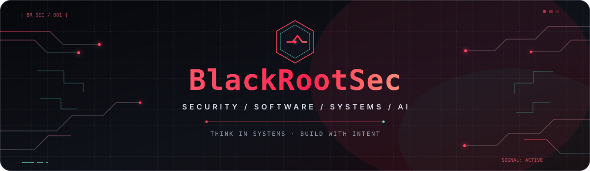

<!--
  BlackRootSec — profile README
  Copy this README.md and the assets/ folder into the public repository
  whose name exactly matches your GitHub username: BlackRootSec.
-->

 

  
  
  
  

**Curiosity is the entry point. Systems thinking is the advantage.**

[Explore the repositories](https://github.com/BlackRootSec?tab=repositories) · [View activity](https://github.com/BlackRootSec?tab=overview)

---

## `01 / PROFILE` — Beyond the surface

I’m **BlackRootSec** — a technology enthusiast drawn to the places where **software, security, networks, and intelligent systems** meet.

I like understanding what happens beneath the interface: how applications are designed, how systems communicate, where assumptions break, how complex workflows can be automated, and how AI can make technical work more useful.

My approach is hands-on and multidisciplinary: investigate the details, question the defaults, test hypotheses, document what matters, and keep learning.

<table>
<tr>
<td width="50%" valign="top">

### ◈ Build

Web experiences, developer utilities, automation, APIs, and practical software experiments.

</td>
<td width="50%" valign="top">

### ◈ Investigate

Application behavior, attack surfaces, system design, network traffic, and security assumptions.

</td>
</tr>
<tr>
<td width="50%" valign="top">

### ◈ Understand

Operating systems, protocols, infrastructure, code quality, and the trade-offs behind engineering decisions.

</td>
<td width="50%" valign="top">

### ◈ Explore

AI-assisted workflows, LLM applications, intelligent automation, and emerging developer tools.

</td>
</tr>
</table>

## `02 / DOMAINS` — Where I focus

| Domain | The interesting problems |
|---|---|
| **Web engineering** | Accessible interfaces, application architecture, APIs, performance, and maintainability |
| **Security research** | Threat modeling, vulnerability analysis, secure design, and responsible disclosure |
| **Bug bounty & pentesting** | Scoped testing, attack-surface mapping, careful validation, and actionable reports |
| **Networks & systems** | Protocol behavior, traffic analysis, Linux/Windows environments, and troubleshooting |
| **Automation** | Reproducible workflows, scripting, CLI tools, and reducing repetitive work |
| **AI & intelligent tools** | LLM-powered applications, retrieval workflows, evaluation, and human-in-the-loop automation |

## `03 / TECH RADAR` — A map, not a checklist

Technology is a landscape to explore, not a badge collection. The ecosystem below reflects areas of interest and possible project directions; it **does not imply equal proficiency or production experience with every technology listed**.

<b>⌘ Languages & application engineering</b>

 

<b>◫ Web, APIs & data</b>

 

<b>⌬ Security, networks & operating systems</b>

 

<b>⛭ Cloud, infrastructure & delivery</b>

 

<b>✳ AI, data intelligence & automation</b>

 

**Concepts on my radar:** LLM application design · retrieval-augmented generation (RAG) · embeddings and vector search · model evaluation · AI-assisted workflows · human-in-the-loop automation.

## `04 / PRINCIPLES` — How I like to work

- **Understand before automating.** Know the system and its failure modes before adding more tools.
- **Prefer evidence over assumptions.** Reproduce behavior and document findings clearly.
- **Build for maintainability.** Readable code, focused scope, helpful documentation, and sensible defaults matter.
- **Use security responsibly.** Work within authorization and defined scope; disclose vulnerabilities safely.
- **Stay a student of technology.** Tools change. Fundamentals and curiosity travel further.

## `05 / CURRENT TRANSMISSION` — Experiments & notes

This profile is a living lab for technical experiments, useful utilities, engineering notes, and ideas worth testing. I prioritize projects that solve a real problem, teach a deeper concept, or make a workflow simpler.

> **What I value in a project:** a clear purpose, thoughtful implementation, reproducible results, and documentation that respects the next person who reads it.

## `06 / SIGNAL` — Connect through the work

The best place to start is the code, issues, and discussions. If a project sparks an idea, open a thoughtful issue or contribute a useful improvement.

 

 

 

**Learn deeply. Build boldly. Secure thoughtfully.**

Independent by curiosity · Responsible by design · Open to what’s next

